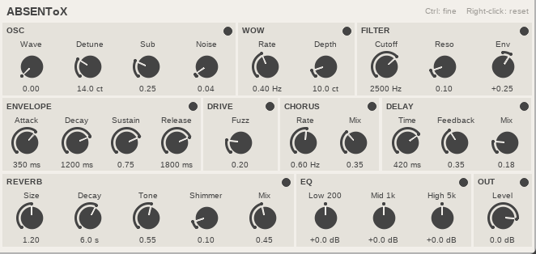

# ABSENToX

A small dream-pop and shoegaze synth for [REAPER](https://www.reaper.fm/), made for low-spec PCs.

## Install

| System | Download | Then |
|---|---|---|
| **Windows** | [ABSENToX-Windows.zip](https://github.com/absentlo/absentox/releases/latest/download/ABSENToX-Windows.zip) | Unzip it and double-click `install.bat` |
| **Linux** | [ABSENToX-Linux.tar.gz](https://github.com/absentlo/absentox/releases/latest/download/ABSENToX-Linux.tar.gz) | Extract it and run `./install.sh` |

Restart REAPER after installing.

On a portable REAPER, pass its folder to the installer, or copy `absentox.jsfx` into its `Effects` folder.

## Play

1. On a track, open the FX window, click **Add** and search for `ABSENToX`.
2. Arm the track and turn on monitoring.
3. Open **View > Virtual MIDI Keyboard** and hold a chord. The default sound fades in slowly.

## Controls

- **Drag up or down:** turn a knob.
- **Ctrl + drag:** turn it slowly.
- **Right-click:** reset a knob.
- **Circle at the top right of a section:** switch it on (filled) or off (hollow). Your settings stay.
- **+ next to the preset list:** save a sound.

## Sections

| Section | Knobs | When OFF |
|---|---|---|
| **OSC** | Wave (saw to square), Detune (width), Sub (octave down), Noise | No new sound; tails keep ringing |
| **WOW** | Rate, Depth: slow pitch drift, like a tremolo arm | Pitch is steady |
| **FILTER** | Cutoff (brightness), Reso (emphasis), Env (how much a note opens or closes it) | Fully open |
| **ENVELOPE** | Attack, Decay, Sustain, Release | Notes start and stop at once |
| **DRIVE** | Fuzz | Clean |
| **CHORUS** | Rate, Mix | Dry |
| **DELAY** | Time, Feedback, Mix | Dry |
| **REVERB** | Size, Decay (up to 30 s), Tone, Shimmer (octave up), Mix | Dry |
| **EQ** | Low 200 Hz, Mid 1 kHz, High 5 kHz | Flat |
| **OUT** | Level | Muted |

## Good to know

- **No sound?** Check that the track is armed and monitored, and that **OSC** and **OUT** are ON.
- **Save CPU:** turn off what you don't use. **REVERB** costs the most.
- **Limits:** 6 notes at once, pitch bend but no sustain pedal, and delay time doesn't follow tempo.

## Developers

`python3 tests/smoke.py` renders the plugin through REAPER and checks the audio. Pushing a tag like `v1.0.0` builds both downloads and publishes a release.

## License

[MIT](LICENSE)
